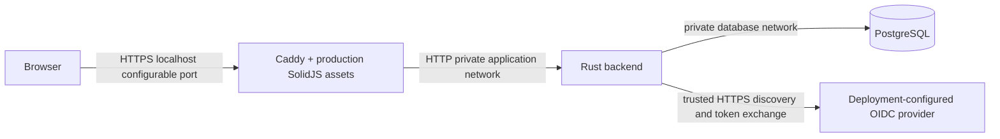

# Development installation architecture

## TL;DR

The edge owns HTTPS and static UX delivery. The backend owns authentication,
authorization, migrations and application behavior. PostgreSQL is private.
This repository owns composition and qualification, not application logic.

Only `127.0.0.1:<port>` is published. The database network is internal;
the backend also joins the application network for provider egress. The edge
cannot join the database network. This is local development, not a production
network security or availability design.

The backend and edge run as UID 10001 with read-only roots, dropped capabilities,
no-new-privileges, memory/PID limits and bounded temporary storage. The official
PostgreSQL entrypoint retains the capabilities needed to initialize and change
ownership of its data directory. It has a separate named volume and no host port.

The local CA and database survive ordinary down/restart. Only qualification
removes its positively identified volumes. Never export the CA private key.

## Artifact and configuration boundaries

[Artifact lock](local/artifacts.lock.json) pins source commits, image manifests
and tools. Deployment-owned Dockerfiles build those exact sources. OCI labels,
local image IDs and a packaging digest are verified before Compose can start.
Sibling working trees are never changed. No floating application tags are used
as the runtime authority.

There is no browser API environment injection: the existing UX uses its own
origin. Edge routing preserves Host, Origin, Cookie and Set-Cookie and overrides
API cache headers with no-store. Missing assets and API paths do not get the SPA
index. The UX's reviewed inline theme bootstrap is retained; this slice does not
introduce a CSP incompatible with it.

Private instance files supply the database password and confidential OIDC client
secret. The backend entrypoint reads mounted files and creates environment
variables only inside its container. Normal startup requires complete OIDC
settings and successful trusted HTTPS discovery.

## Qualification boundary

`pnpm qualify` runs the real artifacts in **unconfigured identity mode**,
which deliberately has no protected identity/application routes. A temporary
synthetic upstream separately proves proxy semantics; it is neither an OIDC
provider nor an authentication qualification. The real backend is restored
before cleanup.

Original plan PR 12 owns trusted-provider browser sign-in, session and tenant
authorization qualification. See the [active plan](docs/exec-plans/active/m02-development-installation.md).
