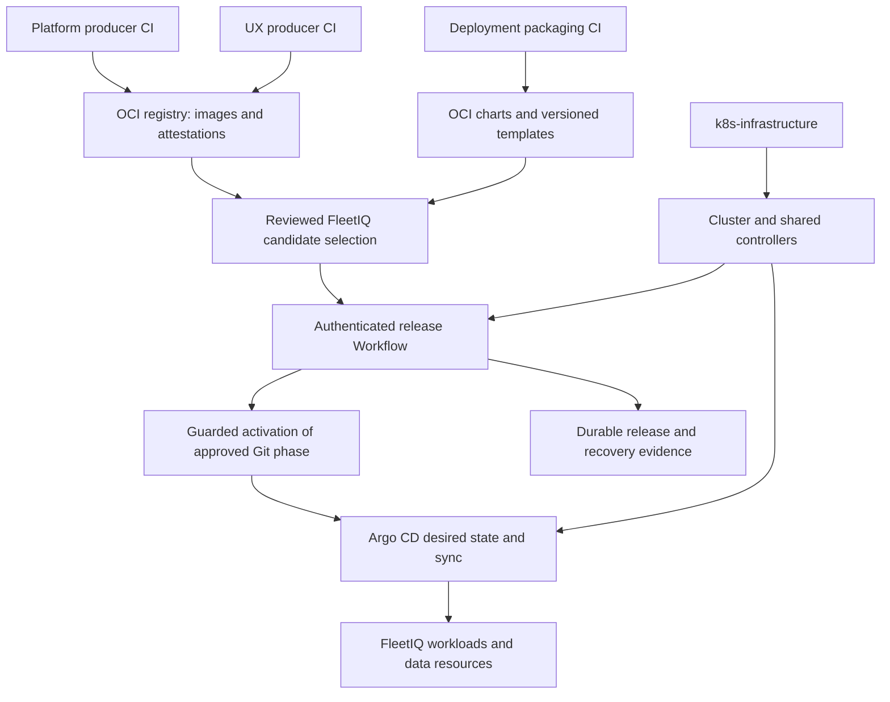
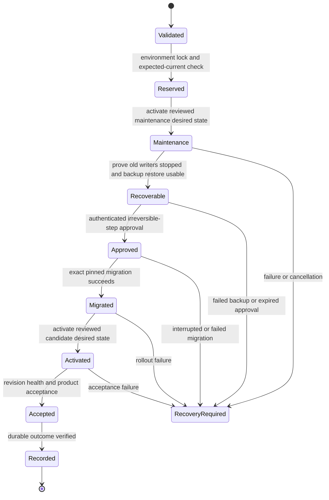

# Kubernetes GitOps deployment architecture

Status: Proposed target; planning only. Reviewed 2026-10-17.

## TL;DR

- Use the shared Kubernetes substrate, Helm OCI packages, Kustomize composition,
  Argo CD reconciliation and Argo Workflows release orchestration locally and
  remotely. Different capacity and identity settings do not require new tooling.
- `fleetiq-deploy` owns FleetIQ environments and promotions; `perfeng-environment`
  continues to own Perfeng. Neither becomes the other's deployment dependency.
- The provider needs consumer isolation and qualified networking, storage, access
  and controller capabilities before FleetIQ can use the existing cluster safely.
- Select candidates separately from activating them. Migration failure keeps a
  durable maintenance state; reverting Git cannot reverse a database migration.
- Local qualification is the first outcome. Multi-user, recoverable non-local
  operation is a separately measured readiness outcome, not a property of kind.

Read the [execution plan](../exec-plans/active/kubernetes-gitops-deployment.md)
for delivery order and the [provider prompt](../handoffs/k8s-infrastructure-consumer-onboarding.md)
for work outside FleetIQ. [ADR 0002](../adr/0002-kubernetes-gitops-target.md)
records the proposed decision.

## Findings from the actual repositories

These are source observations, not claims about a live cluster. No kubeconfig,
credential, cluster resource or private instance file was inspected.

| Evidence inspected | Observation and implication |
| --- | --- |
| `k8s-infrastructure` main `73a28e76059a880141f280c075aa563428396034` | Cluster/Argo CD lifecycle code and the namespaced Workflows add-on exist. [PR 21](https://github.com/stanimirivanov/k8s-infrastructure/pull/21) merged during this review; the initial inspected branch was `feature/issue-20`. A merged installer is not proof of live installation or second-consumer qualification. |
| Provider `scripts/local_kind.py`, cluster profile and capability contract | Only the exact `perfeng-local` / `kind-perfeng-local` profile is implemented, with Perfeng-specific worker placement. A second consumer is not an independently qualified profile. |
| Provider `scripts/workflows.py` and ADR 0003 (still marked proposed in the inspected guide) | The controller/server run with `--namespaced` in `argo-workflows`. No FleetIQ execution namespace, identities, artifact store or release authority is provided. |
| Provider local-kind and Argo CD operating guides | They still describe the Perfeng ownership cutover as pending. |
| `perfeng-environment` `40726e131e7832d72d00bfe3fd4c3bc724ff9163`, local infrastructure selection and operating guide | Its guide records the cutover as accepted and selects provider `5970bffa1f3d200e73d5a55e0cd4ef34ed9ef3b7`. This conflicts with provider guidance; reconcile the records, do not repeat the cutover. The working branch was `feature/issue-151`; these are observations, not a new FleetIQ source pin. |
| FleetIQ deployment [PR 2](https://github.com/stanimirivanov/fleetiq-deploy/pull/2) | Compose packaging and qualification remain under review. Preserve that PR; its local image IDs, private directories and synthetic proxy test are not published Kubernetes artifacts or real identity qualification. |
| Platform `crates/server/src/lib.rs`, `main.rs`, `bootstrap.rs`, OIDC provider adapter | Serve/bootstrap apply embedded migrations; there is no separate migration-only command or production no-DDL serve mode. OIDC requires trusted HTTPS, with no explicit additional-CA configuration. Kubernetes packaging needs upstream runtime changes. |

The profile does not establish enforced NetworkPolicy, public TLS/Gateway,
production storage, recovery or multi-user Argo access. Require qualification,
not assumptions from a manifest's presence. Kubernetes explicitly requires a
[network plugin that enforces NetworkPolicy](https://kubernetes.io/docs/concepts/services-networking/network-policies/#prerequisites).

## Responsibility and repository boundaries

| Responsibility | Owner |
| --- | --- |
| Build/test/publish backend and migration image | `fleetiq-platform` producer CI |
| Build/test/publish production UX/static edge image | `fleetiq-ux` producer CI |
| Package/publish reusable FleetIQ charts and release-template artifacts | `fleetiq-deploy` packaging CI, separate from promotion authority |
| Review candidate artifacts, environment policy and promotions | `fleetiq-deploy` environment records and reviewers |
| Reconcile FleetIQ desired resources | FleetIQ-owned Argo CD Applications |
| Execute a bounded release and retain outcome evidence | FleetIQ Argo Workflows templates and authorized operators |
| Provision cluster, CNI/storage/Gateway capabilities and shared controllers/CRDs | `k8s-infrastructure` and the substrate operator |
| Select Perfeng artifacts and operate Perfeng workloads | `perfeng-environment`; unchanged |

No new FleetIQ repository is necessary initially. Build projects may later use
Tekton or Dagger without changing the release-request contract. Do not add those
engines to solve deployment orchestration now.



Workflows must not patch Argo-owned Deployments, StatefulSets, Services, database
Cluster objects or scaling fields directly. Operator-managed database child Pods
are owned by that operator, not by a second Helm release. Maintenance and replica
changes are reviewed Git desired state reconciled through Argo CD. Workflows own
only their transient execution Pods and explicit external-state operations.
Argo CD also reconciles approved, immutable-versioned WorkflowTemplates and
execution RBAC. Submit Workflow instances outside GitOps; do not commit a live
release run that reconciliation could recreate. Retain template versions while
referencing runs remain active, instead of mutating them during a suspended run.

## Package once; configure environments explicitly

Use producer images by `sha256` digest, Helm OCI packages by digest, and immutable
release-tool/template versions. Keep provenance, source revision, SBOM, migration
checksums, schema compatibility and verification results bound in a release bill
of materials. Registry credentials are scoped independently for publish and pull;
no source-read token, developer kubeconfig or registry password enters an image.
[Argo CD's OCI source](https://argo-cd.readthedocs.io/en/stable/user-guide/oci/)
can select a digest; prove the selected controller version renders that package.

Helm owns workload parameters and resource templates. Kustomize composes the Argo
Applications, namespace policies and environment configuration. Do not render
Helm then patch the same fields with a second imperative deployment engine.
Argo CD renders charts; `helm upgrade` is not a second live reconciler.

Proposed deployment layout, to be introduced by the owning slices:

```text
charts/
  fleetiq-runtime/              # backend, static edge, Services, probes, routing
  fleetiq-data/                 # database custom resources, backups, retention
  fleetiq-release-workflows/    # versioned templates and execution identities
contracts/
  release-request-v1.schema.json
  release-receipt-v1.schema.json
gitops/
  projects/                    # narrow FleetIQ source/destination permissions
  environments/local/          # composition; non-secret references only
  environments/staging/
  environments/production/
releases/                      # immutable selections and reviewed phase inputs
tests/                         # rendering, policy, lifecycle and browser journeys
docs/operations/               # onboarding, release, restore, upgrade, access
```

Do not put an active production environment here until it is qualified. A local
profile uses small replicas/storage and trusted development certificates. A
non-local profile uses its selected fault domains, durable storage, external
backup/evidence locations, provider identity and trusted public/private PKI.
Both use the same charts, release state machine and verification rules. Local
node disks are not production durability; port-forwarding is not remote ingress.
The first package covers the implemented HTTP product. M03 device ingestion
adds explicit TCP/UDP exposure, protocol admission and writer/drain qualification;
a working HTTP Gateway does not establish those transport capabilities.
Compose remains a temporary developer diagnostic path, not another release
workflow to maintain forever. Retire its release role after Kubernetes parity.

## Consumer isolation and access

Prefer a provider-owned controller/server in `fleetiq-workflow-system` managing
only the pre-created consumer namespace `fleetiq-releases`. The provider owns
controller RBAC and shared CRDs; FleetIQ owns WorkflowTemplates and execution
identities in the managed namespace. Do not place FleetIQ release jobs alongside
Perfeng jobs in `argo-workflows` merely because that controller already exists.
[Managed namespaces](https://argo-workflows.readthedocs.io/en/latest/managed-namespace/)
provide this separation without requiring a cluster-wide execution controller.

An independently qualified local FleetIQ profile also provides isolated CI
targets. Sharing the retained Perfeng cluster is conditional on explicit
placement, capacity and benchmark-interference acceptance; otherwise request a
separate profile from the same provider without replacing that cluster.

Use `fleetiq-local`, `fleetiq-data` and `fleetiq-releases` as illustrative workload
boundaries; final names are explicit environment policy. AppProjects allow only
FleetIQ sources, destinations and needed resource kinds. Privileged bootstrap
creates/delegates those boundaries once; a release principal cannot create its
own cluster privileges. Administrative and application identities are separate.

Non-local access requires provider-neutral OIDC/SSO for Argo tools, individual
identities, short-lived CI/workload credentials, and distinct viewer, releaser,
approver and administrator roles. The application retains backend-managed OIDC
sessions, tenant authorization and CSRF protection. Local browser tests use real
signed tokens and trusted TLS, not a disabled authentication profile.

Use controller `templateReferencing: Secure` plus admission/request validation:
submitters cannot replace templates, override entrypoints, choose service accounts,
inject images/commands, or select arbitrary destinations. Secure template
referencing alone still permits some submission fields; it is not the whole
[submission security boundary](https://argo-workflows.readthedocs.io/en/latest/workflow-restrictions/).
An approval is an authenticated, expiring record bound to the release digest and
phase, not a boolean parameter or an anonymous resume click. Require distinct
approver/releaser identities for destructive non-local transitions.

Application and execution Pods use restricted security contexts, bounded CPU,
memory, PIDs where supported, deadlines and storage, default-deny network rules,
and minimal service-account tokens. Allow only documented DNS, provider, API,
database and artifact flows. Test denied cross-consumer access from real Pods.
Do not alter the existing cluster's CNI in place as an onboarding shortcut.

## Data, secrets and recovery

Recommend CloudNativePG-managed PostgreSQL for both profiles, with its supported
Barman Cloud Plugin for WAL/base-backup object storage. Qualify pinned versions
before selection; avoid the deprecated in-tree object-store backup path described
in the [backup documentation](https://cloudnative-pg.io/docs/1.28/backup/).
The infrastructure owner supplies operator/CRD capabilities; FleetIQ supplies
its Cluster, database policy, credentials, backup schedules and restore requests.
A separately reviewed managed-PostgreSQL profile is possible later; it is not
assumed to be interchangeable without qualification.

App database credentials have no DDL authority in production. A migration job
gets separate, temporary credentials and applies the image's exact embedded
migration set. Serve checks schema compatibility and fails readiness if it cannot
run safely. SQLx advisory locking does not substitute for release serialization.
First-install bootstrap is an explicit, idempotent audited operation, not an init
container that silently grants the first web visitor administrator authority.

Application Secrets are references to an approved external secret backend or
privately supplied local Kubernetes Secrets. Define rotation/revocation and
Secret encryption at rest for non-local targets. Local test secrets remain
untracked; Kubernetes base64 encoding is not encryption. Trust includes the
browser, backend-to-OIDC client, registry and backup endpoint; never disable
certificate or issuer verification to make the local profile work.

Backup readiness requires usable credentials, a complete backup and WAL chain,
retention policy and a successful restore into an isolated database. Record the
actual restore point, data validation and measured recovery time. Backups and
release evidence need separate access scopes and must survive application/cluster
loss on a non-local target. Same-cluster PVC copies prove only a local drill.
Define numeric RPO/RTO with the owner before any non-local acceptance; measure
rather than inventing an availability or recovery claim.

## Release contract and state machine

A versioned request binds environment/cluster incarnation, immutable release ID,
expected current receipt, producer image/chart/template digests, exact Git phase
commits/selection hashes, migration compatibility/checksums, backup requirements,
approval policy and deadlines. It contains no credentials or user-supplied shell.
Unknown fields, wrong cluster, unreviewed sources, missing history or a stale
expected-current value fail before mutation. The Perfeng request is useful prior
art; FleetIQ has its own schema and authority, not a Perfeng deployment lock.



The release steps are bounded DAG tasks. Workflows supplies
[DAG dependencies](https://argo-workflows.readthedocs.io/en/latest/walk-through/dag/)
and [suspend/resume](https://argo-workflows.readthedocs.io/en/latest/walk-through/suspending/),
but the workflow must revalidate identity, approval and observed state after a
resume. Pre-maintenance failures retain a failed receipt without changing service.
First install uses a separately verified empty target and explicit bootstrap;
it never uses a missing previous receipt as evidence that an existing target is empty.

Candidate selection and activation are different Git authorities. The proposed
mechanism is a protected environment activation ref advanced by compare-and-swap
only to pre-reviewed phase commits. A candidate PR does not move that ref. The
release principal has narrowly scoped promotion authority; producer CI does not.
The maintenance phase remains desired until explicitly replaced, including after
workflow loss. Protection, authorization and rejection of unreviewed ref updates
are required acceptance evidence, not assumed from a naming convention.

Argo CD reconciles the active selection. A release requests sync only after the
Application source configuration and all child sources match the approved phase;
then verifies observed revisions, rendered digests and application health. A bare
`sync --revision` against an Application still tracking a different selection is
not valid activation. Sync rights must not permit arbitrary revision/manifest
[override](https://argo-cd.readthedocs.io/en/stable/operator-manual/rbac/#the-override-action).
Any shared Argo security-setting change requires the infrastructure owner's
compatibility review with existing Perfeng users.

Hold an environment-scoped workflow mutex for the run, with durable prior/outcome
records and compare-and-swap promotion state to protect retry/restart boundaries.
A controller-local mutex is not a multi-controller/global lock. One authorized
controller per environment is the initial limit; expanding that boundary requires
qualified [shared synchronization](https://argo-workflows.readthedocs.io/en/latest/synchronization/).
Also prove the migration process exits and no old writer remains; force-removing
a lock after a crash is not proof of quiescence. On incomplete recovery the next
release refuses to proceed even if Argo has released its mutex.

Before a disruptive migration, maintenance must fence HTTP writes, background
cleanup, ingestion listeners, processing/replay jobs and any other schema writer.
Initially enumerate the server writers; add M03 workers before they can ship.
Prove termination/drain using observed Pod/process and database activity evidence.
Apply a checked backup/restore precondition, then run the separately authorized
migration. Do not hide this sequence in recurring Helm hooks or broad automatic
retries. Expand/contract changes may later allow a qualified online release.

Every attempt retains request digest, actor/approval references, observed cluster
and Git/artifact revisions, workflow UID, phase outcomes, migration/backup IDs,
recovery state and evidence digests. Store evidence outside transient Workflow/Pod
objects before TTL collection. Export failure records even when migration or
acceptance fails; a missing receipt is incomplete, never success. Exclude tokens,
cookies, subjects, database dumps and raw secret-bearing logs from routine reports.

## Recovery and readiness limits

A failed release is not an atomic transaction. After schema mutation, default to
maintenance plus diagnosis and a reviewed forward fix or restore into a new data
target. Do not automatically reverse SQL, switch back to incompatible binaries,
remove PVCs, rotate credentials or resume writers in an exit handler.
A compatible binary rollback is a new approved promotion with proven schema
compatibility. Restoration requires reconciliation of data, application version,
session/identity state and the accepted data-loss window.

The local acceptance boundary proves install, real browser identity, upgrade,
maintenance/drain, backup/restore, interrupted-release recovery, cross-consumer
isolation and bounded cleanup using the same packages. It does not prove host-loss
recovery, multi-zone availability or production capacity. Non-local readiness adds
private administration, multi-user controls, durable off-cluster recovery,
controller/storage failure drills, SLO/load evidence and staffed operating guides.
