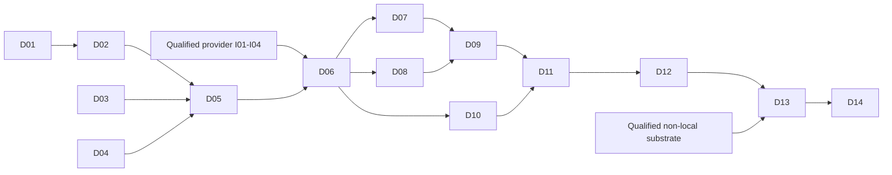

# FleetIQ Kubernetes GitOps delivery plan

Status: In progress; planning issue #3. D01-D05 merged. D06 is blocked on provider
qualification and accepted artifact selections; the prerequisite assessment is
tracked in [issue #9](https://github.com/stanimirivanov/fleetiq-deploy/issues/9).

## TL;DR

- Deliver 14 FleetIQ implementation PRs after this planning PR: two in platform,
  one in UX and eleven in deployment. Local foundation comes first; production
  acceptance remains explicit M08 work.
- Four provider-owned local onboarding slices, building on the merged Workflows
  add-on, unblock use of the shared substrate. They are not FleetIQ implementation PRs.
- Reuse immutable OCI images, Helm charts, Kustomize and versioned Argo templates
  in every environment. No parallel production Compose release system.
- Keep the pending Compose PR intact, prove Kubernetes identity/recovery parity,
  then retire its release role. Do not destroy or adopt existing Perfeng state.
- Read the [architecture](../../architecture/kubernetes-gitops-deployment.md)
  and give the [handoff prompt](../../handoffs/k8s-infrastructure-consumer-onboarding.md)
  to the infrastructure-owning project before enabling live installation.

## Scope and milestone mapping

This replaces the technology/delivery path for original M02-M04 plan PR 11
(development installation) and PR 12 (real browser qualification), not the
already delivered metadata APIs or future ingestion/semantic features. The
[original plan](https://github.com/stanimirivanov/fleetiq-platform/blob/main/docs/development/plans/m02-m04-delivery.md)
retains its numbering; use the D identifiers below to avoid renumbering it.

M02 - Product Foundation owns the operable local installation and release
foundation. M04 - Semantic Twin and Live UI owns real connected browser
qualification. M08 - Production Readiness owns non-local access, resilience and
production acceptance. These are FleetIQ milestones; the infrastructure project
uses its own roadmap. No issue is assigned to multiple milestones.

Deployment PR #2 is merged and remains the temporary Compose diagnostic baseline.
D01-D03 producer interfaces are merged. Their source completion does not select
published artifacts or authorize a Kubernetes installation; D05/D06 own those gates.
Each implementation issue selects exact merged inputs before starting.

## Required provider prerequisites

The [handoff prompt](../../handoffs/k8s-infrastructure-consumer-onboarding.md)
contains exact evidence and acceptance. The provider owner should deliver:

| ID | Cohesive provider work | Dependency and exit gate |
| --- | --- | --- |
| I01 | Project-neutral consumer onboarding and qualified target profiles, preserving existing Perfeng identity/state | Resolve stale cutover records; prove offline previews, exact context/cluster checks, no adoption and safe disposable FleetIQ qualification target. |
| I02 | Isolated FleetIQ Workflows controller/managed namespace and delegated execution boundary | Use merged provider PR 21 (`73a28e76059a880141f280c075aa563428396034`), then I01. Prove shared CRDs have one owner, controller scopes do not overlap, submission restrictions and negative RBAC/admission tests. |
| I03 | Local network/TLS capability profile suitable for isolated consumers | I01; explicitly qualify policy-enforcing CNI, a maintained Gateway implementation, trusted certificates and denied cross-consumer traffic. No unreviewed in-place CNI replacement. |
| I04 | Stateful operator/storage capability profile | I01; qualify storage retention and CloudNativePG/Barman plugin controller capabilities, supported versions and recovery interfaces without creating FleetIQ databases or reading consumer secrets. |

I02-I04 can develop in parallel once I01's boundary is agreed; some cluster-level
changes may require separate owner-approved substrate maintenance. Do not treat
source completion as proof of live qualification. A non-local provider is not
currently established; its provisioning/cost/access work is owned by that
project and must precede D13/D14.

## Verification vocabulary

- **P:** Existing platform authoritative acceptance, Rust/PostgreSQL, architecture,
  migration and supply-chain groups, plus tests for the changed runtime contract.
- **U:** Existing UX structural/browser/browser-quality groups, POM journeys and
  artifact inspection; mocks never substitute for deployment acceptance.
- **H:** Deployment structural checks and new offline Helm lint/template,
  Kustomize rendering, Kubernetes/custom-resource schema and policy validation,
  Argo lint, fixture mutation tests, dependency/secret scans and source-bound
  evidence. Introduce these in D04/D05 alongside their authority/CI wiring.
- **K:** Explicitly authorized disposable-cluster qualification against exact
  provider/runtime artifacts, bounded waits and complete owned cleanup. Missing
  prerequisites or skipped scenarios produce incomplete results.
- **R:** Release failure/recovery and real restore qualification; validate durable
  evidence after transient Workflow/Pod cleanup and across interrupted execution.

No guessed future CLI command is already available. Each owning PR introduces
its concrete harness commands, pins and mandatory CI catalogue entries together.
Use major-version GitHub Action references as requested, while pinning runtime
tools, images, charts and infrastructure source. Keep PR-only verification;
producer publication is an explicit protected release operation, not an added
full test workflow on every push to main.

## Ordered FleetIQ implementation slices

### PR D01: Establish the production runtime and migration contract

- **Repository / milestone:** `fleetiq-platform`; M02 - Product Foundation.
- **Objective & Scope:** Add explicit migration-only execution and a serve mode
  that checks compatibility without performing DDL. Complete deployment trust
  inputs for a mounted additional OIDC CA bundle without weakening verification.
- **Target Layers / Files:** `crates/server/src` process/configuration/startup and
  OIDC adapter, PostgreSQL migration boundary, runtime tests and operating docs.
- **Contracts & Boundaries:** Separate migration/app roles, schema readiness,
  immutable migration inventory and errors; preserve existing default development
  compatibility explicitly. Include explicit bootstrap behavior, health and
  graceful-stop guarantees; no Kubernetes client in domain/application crates.
- **Harness Gate:** P; missing/stale schema, no-DDL role, migration locking/failure,
  malformed/untrusted CA, valid trusted OIDC, termination and redaction tests.
- **Dependencies / Parallelism:** Available now; independent of provider delivery.

### PR D02: Publish the backend image and migration provenance

- **Repository / milestone:** `fleetiq-platform`; M02 - Product Foundation.
- **Objective & Scope:** Own and publish the production backend image upstream,
  including D01's commands and source/migration provenance. Exercise the built
  artifact rather than relying on a deployment checkout compiling source.
- **Target Layers / Files:** Source-owned Dockerfile/build context, producer CI,
  image smoke qualification, SBOM/provenance output and release documentation.
- **Contracts & Boundaries:** Digest-addressed registry output, source revision,
  supported architecture and migration set; build permissions cannot deploy an
  environment. Transfer packaging responsibility from PR #2 without double ownership.
- **Harness Gate:** P plus real image health/nonroot/read-only/graceful-stop,
  migration-only command, scan/provenance checks and immutable publication policy.
- **Dependencies / Parallelism:** D01; parallel with D03 and D04.

### PR D03: Publish the production UX/static edge artifact

- **Repository / milestone:** `fleetiq-ux`; M02 - Product Foundation.
- **Objective & Scope:** Package the existing production UI and static edge once,
  with configurable private backend routing and externally terminated TLS support.
- **Target Layers / Files:** Production Dockerfile/edge configuration, producer CI,
  package tests and delivery docs; keep domain/UI code unchanged unless required.
- **Contracts & Boundaries:** Same-origin `/api`, deep links, no-store API policy,
  correct Host/Origin/cookies, no browser credentials or environment-specific rebuild.
- **Harness Gate:** U plus real built-image routing/header/probe and restriction
  tests, content/bundle budgets, SBOM/provenance and digest publication checks.
- **Dependencies / Parallelism:** Available now; parallel with D01/D02 and D04.

### PR D04: Package FleetIQ workloads and introduce manifest fitness gates

Implementation: candidate in issue #5. The [package contracts](../../operations/kubernetes-packages.md)
describe real offline qualification and its limits; no live environment is activated.

- **Repository / milestone:** `fleetiq-deploy`; M02 - Product Foundation.
- **Objective & Scope:** Create reusable Helm runtime/data packages and environment
  composition with complete local fixtures and explicit production-required values.
  Add the corresponding offline self-validating harness in the same slice.
- **Target Layers / Files:** `charts/fleetiq-runtime`, `charts/fleetiq-data`,
  environment composition, rendering/policy tests, tool pins and CI authority.
- **Contracts & Boundaries:** Only digest images; existing Secret references,
  CNPG custom resources, Gateway routes, private Services, startup/readiness,
  resource/security contexts, retention and explicit maintenance values.
- **Harness Gate:** H; schema-invalid values, privilege/exposure, floating image,
  missing trust/identity, schema mismatch and accidental destructive-prune fixtures.
- **Dependencies / Parallelism:** Review D01-D03 interfaces; implement with fixture
  digests in offline tests while publishers and I01-I04 progress. No live activation.

### PR D05: Publish release packages and enforce candidate/promotion contracts

- **Repository / milestone:** `fleetiq-deploy`; M02 - Product Foundation.
- **Objective & Scope:** Publish charts as OCI artifacts and produce a release bill
  of materials. Validate immutable requests, receipts and separately authorized
  candidate versus active environment selections before introducing a deploy command.
- **Target Layers / Files:** `contracts`, `releases`, packaging CI, selection and
  evidence validation, promotion policy fixtures and operating documentation.
- **Contracts & Boundaries:** Exact producer/chart/tool/template/infrastructure
  digests, cluster incarnation, expected-current receipt, reviewed phase commits,
  migration policy and expiry. Verify review/provenance independently of schema validity.
- **Harness Gate:** H; retagged/missing artifacts, wrong cluster, stale current,
  dirty/unreviewed Git inputs, replay, unknown fields, expired policy and candidate
  merges attempting to activate workloads must fail. Pin OCI rendering support.
- **Dependencies / Parallelism:** D02-D04. Contract work may overlap publishers;
  real publication/qualification waits for their accepted artifacts.

### PR D06: Onboard FleetIQ and qualify the first persistent Kubernetes installation

- **Repository / milestone:** `fleetiq-deploy`; M02 - Product Foundation.
- **Objective & Scope:** Add preview-first consumer bootstrap and deploy the locked
  package through FleetIQ AppProjects/Applications on an explicitly selected
  qualified substrate. Wire database, secrets, trusted HTTPS and real OIDC config.
- **Target Layers / Files:** `gitops/projects`, `gitops/environments/local`, bounded
  onboarding tooling and install/isolation/persistence qualification scenarios.
- **Contracts & Boundaries:** Separate platform-admin bootstrap from release/app
  access; dedicated kubeconfig/context, namespace ownership, quotas and Secret refs.
  No provider install, CRD adoption, Perfeng namespace mutation or plaintext fallback.
- **Harness Gate:** H + K; install/deep-link/private API/TLS, persistence on Pod
  restart, actual allow/deny network probes, wrong owner/context and retained-data
  cleanup behavior. Controlled initial migration/bootstrap is explicit and audited.
- **Dependencies / Parallelism:** D01-D05 plus qualified I01-I04. Initial install
  is deliberately operator-guided; D08 replaces release mutations with the workflow.
- **Readiness (2026-10-19):** Blocked, not implemented or live-qualified. Provider
  main remains `73a28e76059a880141f280c075aa563428396034`; I01-I04 evidence and
  accepted producer publication selections are absent. See the
  [readiness assessment](../../operations/d06-readiness.md) and
  [focused provider prompt](../../handoffs/k8s-infrastructure-d06-unblock.md).

### PR D07: Prove backup, isolated restore and durable evidence storage

- **Repository / milestone:** `fleetiq-deploy`; M02 - Product Foundation.
- **Objective & Scope:** Configure database/WAL backup and evidence retention and
  restore seeded data into a separate target. Deliver the usable recovery
  prerequisite before a workflow can permit a disruptive upgrade.
- **Target Layers / Files:** Data-chart policy, backup/evidence endpoint references,
  restore fixtures, retention checks and recovery operating guide.
- **Contracts & Boundaries:** Separate database/backup/evidence credentials; no
  restore over an existing target, no plaintext dump in reports, explicit local
  durability limits, actual restore point and measured recovery duration.
- **Harness Gate:** H + K + R; unavailable/stale/incomplete backup, missing key,
  WAL gap, failed restore and conflicting target refusal; evidence survives Pod TTL.
- **Dependencies / Parallelism:** D06; can run alongside D08 development.

### PR D08: Execute the first install through a bounded release Workflow

- **Repository / milestone:** `fleetiq-deploy`; M02 - Product Foundation.
- **Objective & Scope:** Deliver an authenticated, versioned WorkflowTemplate for
  first installation: validated request, environment lock, migration/bootstrap,
  approved activation, Argo sync, health checks and retained outcome.
- **Target Layers / Files:** `charts/fleetiq-release-workflows`, narrow execution
  RBAC/admission, activation-ref operation, request/evidence fixtures and runbook.
- **Contracts & Boundaries:** Only a provably empty target accepts null previous
  state. Secure template references plus admission restrict submission; only
  pre-reviewed phase commits can activate by CAS. Argo CD remains workload owner.
- **Harness Gate:** H + K; simultaneous requests, nonempty target, stale ref,
  wrong template/entrypoint/image/identity, arbitrary Argo revision override,
  interrupted install and missing receipt all fail closed with evidence.
- **Dependencies / Parallelism:** D05/D06 and I02; D07 independent but required
  before any existing installation may use the D09 upgrade path.

### PR D09: Orchestrate disruptive upgrades and interrupted-release recovery

- **Repository / milestone:** `fleetiq-deploy`; M02 - Product Foundation.
- **Objective & Scope:** Add the full maintenance/drain, verified-backup, explicit
  irreversible approval, migration and health/acceptance transition. Preserve
  durable recovery-required state and support a reviewed retry or forward recovery.
- **Target Layers / Files:** Release DAGs/templates, phase compositions, approval
  binding, failure/recovery scenarios, compatibility policy and operator procedures.
- **Contracts & Boundaries:** Enumerate all writers, prove stop/drain, revalidate
  after approval/resume, never restart writers automatically after migration failure.
  Include exact expected-current and Git/app revision checks across every transition.
- **Harness Gate:** H + K + R; kill controller/job at phase boundaries, deny self-
  approval where required, expire approval, lose backup access, interrupt migration,
  advance an unexpected ref, fail rollout and request an incompatible rollback.
- **Dependencies / Parallelism:** D07/D08. Future M03 workers must join the tested
  writer inventory before deployment; their absence is not a generic drain claim.

### PR D10: Qualify real browser identity and the connected metadata product

- **Repository / milestone:** `fleetiq-deploy`; M04 - Semantic Twin and Live UI.
- **Objective & Scope:** Fulfil original plan PR 12 against the Kubernetes
  installation, with real signed OIDC and end-to-end backend/database traffic.
- **Target Layers / Files:** Real-provider fixtures, deployment Playwright POM
  journeys, synthetic authorized setup, redacted evidence and user procedures.
- **Contracts & Boundaries:** Sign-in/out, sessions, tenant selection, definitions,
  registration and temporal revisions, CSRF, expiry, revocation and cross-tenant
  denial. Reuse upstream page objects; do not duplicate UX domain behavior.
- **Harness Gate:** H + K + U integration boundary; trusted/untrusted TLS,
  issuer/audience/signature rejection, two real operators/tenants, current access
  checks, persistent upgrade behavior and scanned browser diagnostic artifacts.
- **Dependencies / Parallelism:** D06, D01 trust contract and merged metadata APIs;
  journeys can develop alongside D07-D09, then verify the final release path.

### PR D11: Require release and recovery qualification in deployment CI

- **Repository / milestone:** `fleetiq-deploy`; M02 - Product Foundation.
- **Objective & Scope:** Wire completed install/browser/upgrade/restore scenarios
  into the authoritative disposable-substrate gate with bounded cost and evidence.
- **Target Layers / Files:** Verification catalogue/CI renderer, provider fixture
  selection, scenario orchestration, artifact retention and failure-sensor tests.
- **Contracts & Boundaries:** Consume pinned packages/provider revisions; reject
  missing prerequisites and no-op commands. PR credentials cannot mutate retained
  developer or non-local clusters. Trigger trusted publication separately.
- **Harness Gate:** H + K + R including real browser suite; negative fixtures for
  skipped checks, stale evidence, unsupported capabilities, lost runner/cleanup,
  wrong digest and candidate updates. Verify ownership before deleting fixtures.
- **Dependencies / Parallelism:** D07-D10; harness design may proceed earlier,
  but it cannot attest missing scenarios or silently use the retained Perfeng cluster.

### PR D12: Cut over local operations and retire the Compose release path

- **Repository / milestone:** `fleetiq-deploy`; M02 - Product Foundation.
- **Objective & Scope:** Make the qualified Kubernetes procedure the supported
  local installation, update entry maps/plans and remove duplicated release
  ownership. Keep only clearly bounded developer diagnostics if still useful.
- **Target Layers / Files:** Operator commands/guides, architecture/ADR status,
  active/completed plans and deprecated Compose packaging/build command surface.
- **Contracts & Boundaries:** Existing Compose data is never attached to a new PVC
  by guesswork. Provide explicit export/restore or a reviewed disposable reset;
  preserve the old installation until its replacement passes acceptance.
- **Harness Gate:** H + K + R; document and exercise rollback of the operating
  entry point and data transfer, retained CA/volume behavior and complete removal
  of competing releases. Update deployment documentation map after PR #2 merges.
- **Dependencies / Parallelism:** D09-D11; no dependency on a cloud provider.

### PR D13: Enforce multi-user release authority on a non-local substrate

- **Repository / milestone:** `fleetiq-deploy`; M08 - Production Readiness.
- **Objective & Scope:** Bind an already qualified provider profile to private
  administrative access, operational SSO, short-lived workload/CI identities,
  separate approval roles, secret backend references and audited promotion policy.
- **Target Layers / Files:** Non-local environment policy, scoped Argo projects,
  credentials/admission interfaces, operator-access journeys and threat/runbook docs.
- **Contracts & Boundaries:** Do not provision a cloud account from this repo.
  Owner selects provider, region, budget, domain, trust and identity backend first;
  provider supplies the qualified capabilities. No static admin-token shortcut.
- **Harness Gate:** H + K with authorized target; viewer/releaser/approver/admin
  allow/deny matrix, cross-project denial, expired/revoked identity, prohibited
  ref/template edits, key rotation, secret redaction and tamper-resistant audit.
- **Dependencies / Parallelism:** D09-D12 and separately accepted non-local
  substrate/access capability; no non-local apply is authorized by this plan.

### PR D14: Qualify non-local resilience, upgrades and operational release readiness

- **Repository / milestone:** `fleetiq-deploy`; M08 - Production Readiness.
- **Objective & Scope:** Prove the accepted topology meets owner-defined numeric
  SLO, RPO/RTO, capacity and cost limits through release/recovery exercises and
  publish the supported operating/upgrade procedure.
- **Target Layers / Files:** Non-local acceptance scenarios, monitoring/alert
  interfaces, disaster-recovery and upgrade guides, evidence and readiness record.
- **Contracts & Boundaries:** Survive workload/node/controller disruption and
  restore from off-cluster backup to a fresh target, reconcile data/schema/app
  compatibility and retain approval evidence independently of the failed cluster.
- **Harness Gate:** H + K + R plus measured load/security/availability gates;
  actual failure, restore, backup expiry, credential revocation and evidence-loss
  drills. No production-readiness label if any required result is absent.
- **Dependencies / Parallelism:** D13; scenario design may develop in parallel,
  execution requires explicit target, cost and failure-injection authorization.

## Sequencing and stop conditions

Begin with D01 while the infrastructure owner handles I01-I04; D03/D04 can proceed
in parallel under agreed contracts. Introduce policy sensors with each capability,
not as a later cleanup. D11 makes the integrated gate authoritative.

Stop live work on unknown owner/context/cluster identity, unmerged provider
selection, unsupported capability, missing Secret/trust, inadequate capacity,
unrestorable backup, stale promotion state or failed evidence persistence. Report
what is absent; never repair shared infrastructure implicitly or reduce isolation.
The first locally supported Kubernetes release is complete at D12. The stated
non-local, secure, recoverable, upgradeable multi-user goal requires D13/D14 and
the provider's qualified non-local capability as well. This is deployment
readiness, not a declaration that every product/security obligation in M08 is complete.
